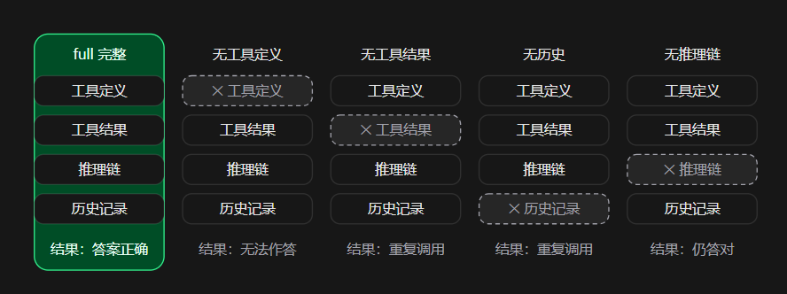
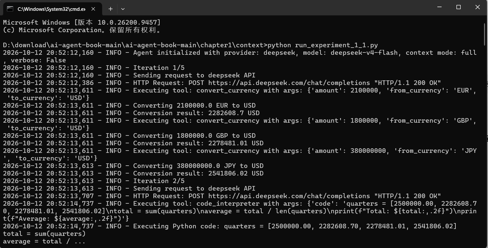
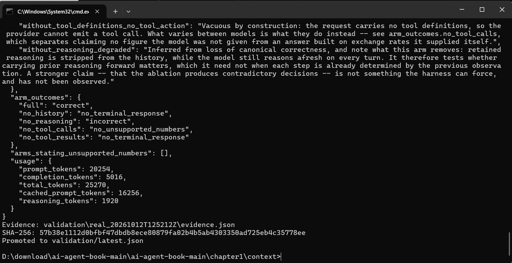

## task0学习笔记：

深入学习了 《深入理解AI Agent》的第一章AI Agent入门，首先书中贯彻的核心概念是Agent = LLM + 上下文 + 工具，

我认为是非常正确的，这也是agent区别于LLM的关键，其中还学习了关于上下文五个部分 静态的系统提示词和工具定义 以及用户信息，模型回复和工具执行结果

并且了解学习了ReAct循环 即思考、行动、观察，是串联LLM、上下文和工具的核心

此外，为解决模型产生幻觉 选错工具 遇到问题无法自我修复的问题 提出来harness，负责协调model和environment的交互

最后提到了工作流和自主agent ，两者区别明显，工作流是确定性的执行路径，而自主agent根据环境反馈实时决定执行路径，

现实当中大多数选择将二者结合。

### 实验部分

五组上下文消融

它让一个 LLM Agent 完成同一个任务（把 Q1-Q4 四种货币的季度营收换算成美元并求年度总额和平均值），但 分 5 组运行，每组从上下文里精确移除一个组件 ，然后对比行为差异：

### 结论和学习成果：

​       上下文即状态 ：LLM 本身无记忆，Agent 的"记忆力"完全来自你每次请求带上的上下文。少一块，行为就退化。

​       消融实验方法论 ：想证明某组件有用，就把它拿掉看系统怎么坏——这是从机器学习借来的 ablation study。

​       工程严谨性 ：区分"完成响应"和"答对任务"、区分"拒答"和"编造数字"、用`arm_produced_inference` 防止"请求根本没发出去却被算作支持结论"——这些都是写可复现实验的好习惯。

### 运行截图：

