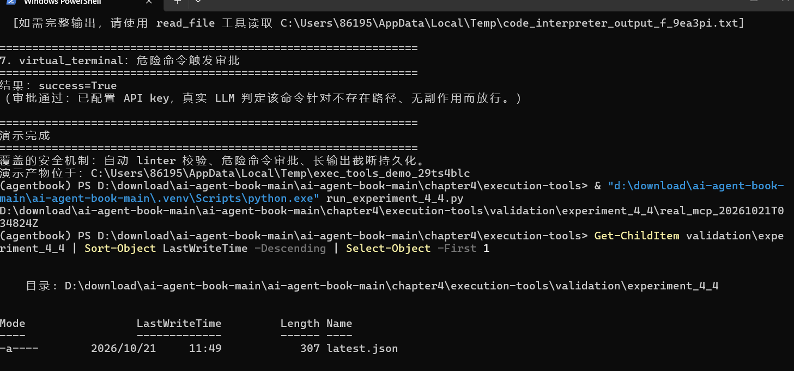
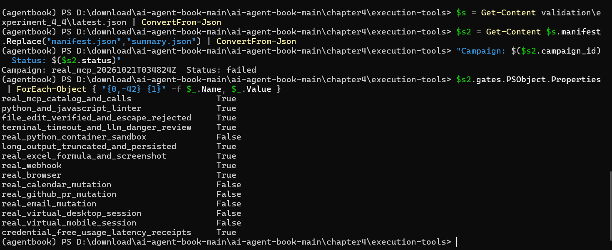
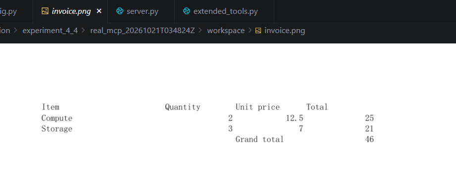
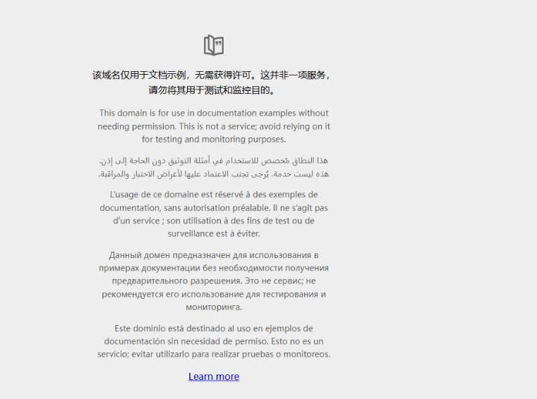

# Task3: Tools 与 MCP

## 核心知识点：

Tools 是 Agent 和外部真实世界交互的载体，相当于 Agent 的手脚，让大模型不再只能输出文本，可以执行操作、获取外部信息。本章把工具分为5大类：

1. 感知工具 Perception：负责采集外部信息（读取文件、网页抓取、查询数据库等），重点是控制返回信息量，避免一下子塞太多内容造成上下文爆炸。
2.  执行工具 Execution：主动发起改动，写文件、跑命令、运行代码、操作浏览器都属于这类。风险最高，必须配套权限、校验、审计机制。
3. 协作工具 Collaboration：用于Agent之间、主Agent和子Agent互相传递任务、结果，支撑多Agent分工。 
4. 事件触发工具 Event Trigger：监听外部事件，满足条件后自动唤醒Agent执行任务。
5.  用户沟通工具 User Communication：专门用来和人交互，确认审批、弹窗询问、输出报告等。

工具数量很多的时候，不一次性全部加载，采用**主动发现、按需加载**，减少模型的选择压力和上下文负担。

## 实验：4-4 执行工具 MCP 服务器

### 实验目的 ：

搭建一套带安全校验的执行工具MCP服务，理解执行工具的风险点，落地安全管控机制：语法自动检查、危险命令审查、输出截断保存。 

工具范围：文件编辑、终端命令、代码沙盒、Excel读写、Webhook、浏览器自动化等。

### 学习小结 ：

之前学的上下文、记忆，解决的是Agent“想什么、记什么”；工具和MCP解决Agent“能干什么、怎么安全地干”。MCP最大价值是标准化，不用给每个Agent单独写一套对接逻辑，一套服务可以被多个Agent复用。执行工具安全是重中之重，一旦管控缺失，会出现删文件、恶意命令等破坏行为。

### 运行截图：

