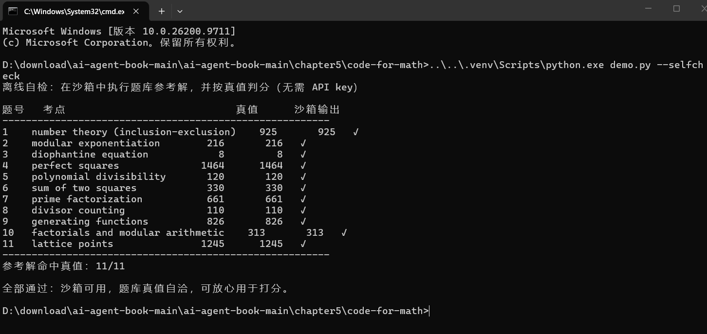
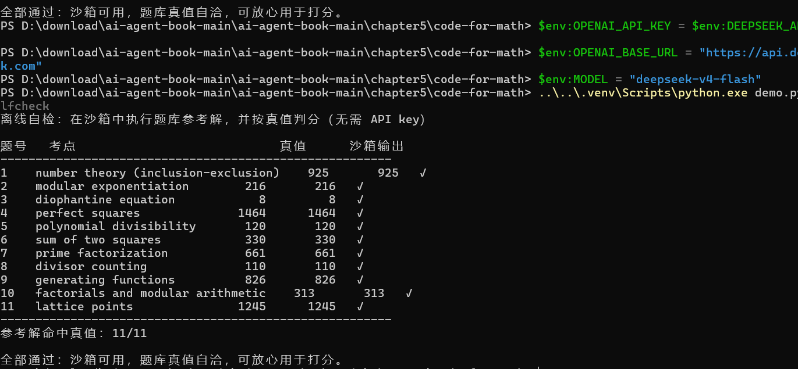
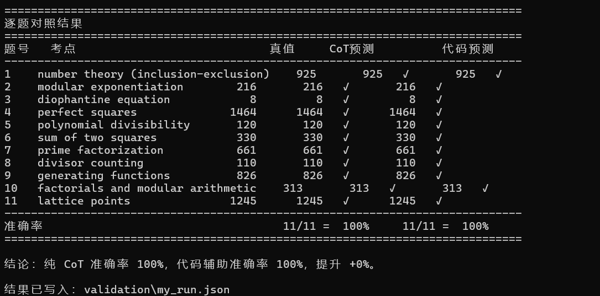

# Task04 笔记｜Coding Agent

1. Coding Agent 核心循环：Read → Think → Edit → Execute → Observe。它不是一次性写完代码，而是拿到运行返回的报错、输出结果，反复调整，靠外部环境反馈不断改错。
2. 基础能力：读取文件、修改源码、在沙盒里执行命令，重点是能拿到完整的运行日志和报错信息，再交给模型判断哪里出问题。
3. Coding Agent 和通用 Agent 区别

- Coding Agent：聚焦代码类任务，工具围绕文件、代码执行，适合计算、脚本编写、调试；
- 通用 Agent：任务没有限定，工具可以是搜索、MCP 服务、数据库等，不一定需要写代码。

1. 核心思路：大模型本身做数学、符号运算容易出错，Coding Agent 把问题转化成可执行代码，借助程序的确定性计算拿到准确结果，弥补模型本身计算不准的短板。

2. 额外要点：沙盒隔离很重要，用来限制命令权限，防止代码误删、执行高危操作；同时代码改动要保留版本，出错时方便回滚。

   ## 实验 5-3 ：使用代码生成工具提升数学解题能力

### 实验目的：

验证借助代码生成工具的 Coding Agent，能不能改善大模型本身数学推理、数值计算容易算错的问题。对比纯文字推理和生成代码运行计算两种方式，看代码执行的反馈能不能提升数学题的正确率。

### 实验结果：

只靠模型直接文字推导时，不少复杂计算步骤会出现计算失误；换成 Agent 生成 Python 代码、执行脚本再读取运行结果的方式，答案准确率明显更高。可以看出代码执行带来了确定性计算能力，弥补 LLM 本身数值运算的缺陷，不过前提是 Agent 要能正确理解题意、写出没有语法错误的代码。

### 运行截图：

