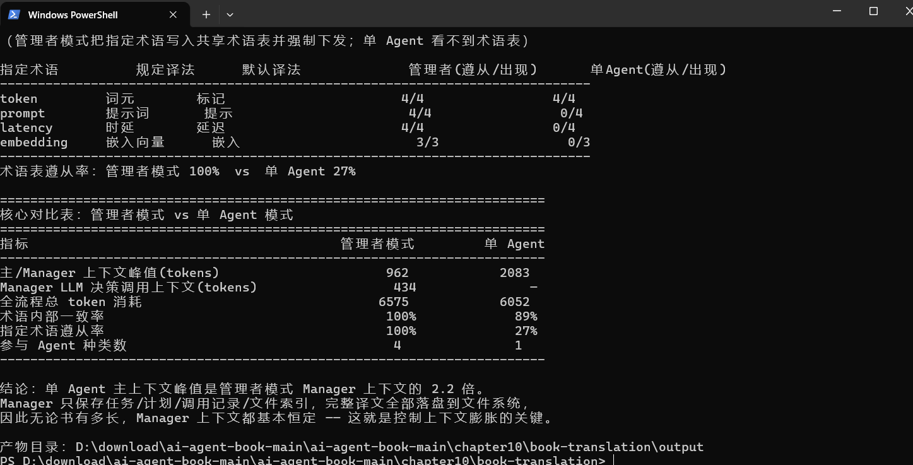
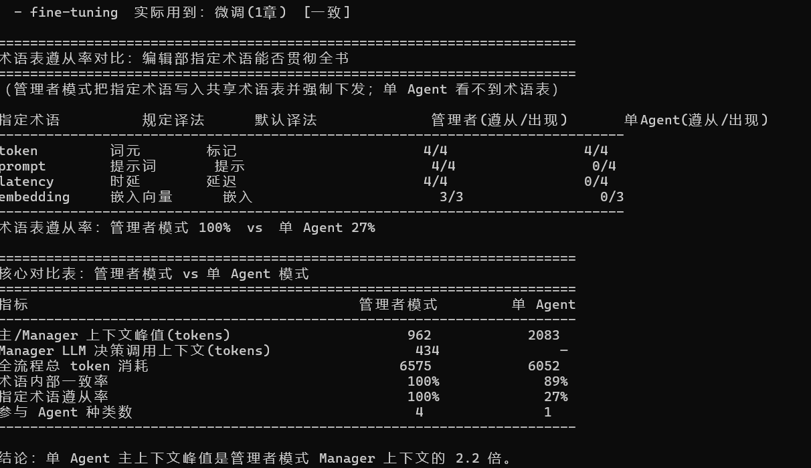

# Task05 笔记｜第 10 章 多 Agent 协作

## 核心知识点

### 多 Agent 两大划分

​     上下文：共享上下文信息同步简单，但容易膨胀、互相干扰；

​      不共享上下文：每个 Agent 独立会话，靠文件 / A2A 交换数据，实现隔离。

#### 协作拓扑

​     管理者（中心化）：主 Agent 拆任务、调度子 Agent，可控易调试，本实验使用该模式。

​     对等协作：Agent 互相评审，容易出现循环扯皮。

​    去中心化：多用于仿真，行为不可控，不适合工程作业。

#### 多 Agent 常见问题：

​    并发文件冲突、错误级联放大、同质趋同、互相扯皮循环、认知投降。

​    工程原则：优先优化单 Agent 的 Harness，任务可拆分再考虑多 Agent。

​    文件系统范式：业务数据存外部文件，Agent 只传路径与指令，控制上下文 token，避免溢出。

## 实验 10‑2 ：书籍翻译 Agent

### 实验目的

单 Agent 翻译整本技术书，会因上下文不断膨胀，出现术语译法前后不一致、幻觉。 搭建**管理者模式多 Agent 系统**，子 Agent 上下文互相隔离，对比单 Agent 与多 Agent 的表现，验证隔离对抑制上下文膨胀、保证术语统一的效果。

### 四类 Agent 分工（上下文隔离，靠本地文件交换数据）

1. **Manager 管理者**：保存任务计划、进度、文件索引；**不加载完整书籍 / 译文**，调度子 Agent，根据审校报告发起修订。
2. **Glossary 术语 Agent**：提取全书专业术语，输出结构化术语对照表。
3. **Translation 翻译 Agent**：仅读取单章原文 + 术语表，完成章节翻译，输出 md 译文。可多实例并行。
4. **Proofreading 审校 Agent**：校验全书译文，检查术语一致性，输出审校报告。

### 实验步骤

1. 准备带代码、专业术语的技术文档作为翻译素材。
2. 多 Agent 组：执行流水线：生成术语表 → 分章翻译 → 审校 → 按需修订；统计各 Agent 上下文、token 消耗。
3. 对照组：单 Agent 处理全部相同素材。
4. 对比两组：上下文大小、术语冲突数量、幻觉、耗时。

### 实验结果

多 Agent 方案：各子 Agent 只加载工作必需数据，Manager 上下文不会随书本篇幅膨胀；独立术语表保障全书译法统一。缺点：LLM 调用变多，总 token 开销更高，要防范文件并发覆盖。

单 Agent 方案：上下文持续膨胀，长文本下容易遗忘术语约定，出现多处翻译冲突，幻觉概率升高。

### 运行截图：

